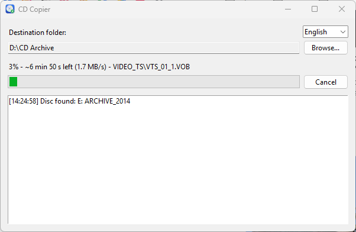

# CD Copier

**English** | [Türkçe](README.tr.md)

A simple Windows app that copies an inserted CD/DVD to a folder of your choice and ejects the disc when it is done. Insert a disc, wait, insert the next one. No extra packages are needed: it uses only Python's standard library (tkinter, ctypes).



## Features

- **Automatic:** detects a newly inserted disc and starts copying on its own.
- **Ejects when done:** the tray opens as soon as every file has been copied successfully.
- **Progress and time left:** percentage, estimated time remaining and read speed. The estimate uses the speed over the last 15 seconds, because CD read speed changes across the disc.
- **Never overwrites:** each disc goes into its own folder named after the disc label. If that name already exists, `Name (2)` is created.
- **Safe on errors:** unreadable files are skipped and listed, the rest is copied, and the disc is **not** ejected so that you notice. Cancelling never leaves half-written files behind.
- **Turkish and English interface:** pick the language in the top-right corner. On first launch it follows the Windows display language.

## Requirements

- Windows 10 or 11
- Python 3.8+ from [python.org](https://www.python.org). During setup, tick "Add python.exe to PATH" and keep "tcl/tk" selected.

## Installation and use

1. Download the project (**Code → Download ZIP**, or `git clone`).
2. Run `kurulum.bat` once: it creates a `.venv` in the project folder and puts a "CD Kopyalayici" shortcut on the desktop.
3. Start the app with `baslat.bat` or the desktop shortcut.
4. Click **Browse...** and choose the destination folder. It is remembered.
5. Insert a disc. Copying starts automatically, and the disc is ejected when it finishes.

To update: run `guncelle.bat` (it runs `git pull` if the folder is a git clone). Your settings are kept.

The batch files are named in Turkish: `kurulum` = setup, `baslat` = start, `guncelle` = update.

## Limitations

- Audio CDs (`.cda` tracks) are not supported: only data discs are copied.
- Copy-protected video DVDs are not decrypted.
- With a USB drive: close the app and use "Safely Remove Hardware" before unplugging it.

## Settings and logs

Stored in `%USERPROFILE%\CdKopyalama`:

- `ayarlar.json`: settings (destination folder, language)
- `hata.log`: error log

## Development

```
python -B -m unittest discover -s tests -v
```

The tests use a fake drive and never touch a real CD.

The icon is drawn by `tools/ikon_olustur.py`. It needs Pillow, but only to regenerate the icon: `python tools\ikon_olustur.py`.

Interface texts live in `cdkopya/dil.py`. When you add a text, add it in both languages; a test checks this.

The code uses Turkish identifiers and comments.

## License

MIT. See [LICENSE](LICENSE).
