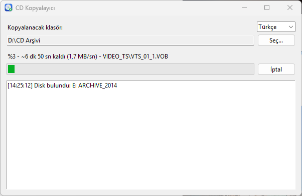

# CD Kopyalayıcı

[English](README.md) | **Türkçe**

Takılan CD/DVD'yi seçilen klasöre kopyalar, kopyalama bitince diski çıkarır. Disk takın, bekleyin, sıradakini takın. Ek paket gerekmez; yalnızca Python'un standart kütüphanesi (tkinter, ctypes) kullanılır.



## Özellikler

- **Kendiliğinden çalışır:** yeni takılan diski görür ve kopyalamaya kendisi başlar.
- **Bitince çıkarır:** bütün dosyalar sorunsuz kopyalanınca tepsi açılır.
- **İlerleme ve kalan süre:** yüzde, tahmini kalan süre ve okuma hızı görünür. CD hızı diskin farklı yerlerinde değiştiği için tahmin son 15 saniyedeki hıza göre yapılır.
- **Üzerine yazmaz:** her disk, diskin adıyla ayrı bir klasöre kopyalanır. Aynı ad varsa `Ad (2)` açılır.
- **Hatada güvenli:** okunamayan dosyalar atlanıp listelenir, kalanlar kopyalanır. Fark etmeniz için disk bu durumda **çıkarılmaz**. İptal edilirse yarım dosya kalmaz.
- **Türkçe ve İngilizce arayüz:** dil sağ üstten seçilir. İlk açılışta Windows'un diline göre gelir.

## Gereksinimler

- Windows 10 ya da 11
- [python.org](https://www.python.org) adresinden Python 3.8 veya üzeri. Kurulumda "Add python.exe to PATH" işaretli, "tcl/tk" seçili kalsın.

## Kurulum ve kullanım

1. Projeyi indirin (**Code → Download ZIP** ya da `git clone`).
2. `kurulum.bat`'ı bir kez çalıştırın: proje klasöründe `.venv` oluşturur ve masaüstüne "CD Kopyalayici" kısayolu koyar.
3. Programı `baslat.bat` ya da masaüstündeki kısayolla açın.
4. **Seç...** ile kopyalanacak klasörü belirleyin. Seçim hatırlanır.
5. CD'yi takın. Kopyalama kendiliğinden başlar, bitince disk çıkarılır.

Güncellemek için `guncelle.bat`'ı çalıştırın; klasör git ile indirildiyse `git pull` yapar. Ayarlarınız korunur.

Klasör başka bir bilgisayara taşınırsa orada bir kez `kurulum.bat` çalıştırın; çalışmayan `.venv` yeniden kurulur.

## Sınırlamalar

- Müzik CD'leri (`.cda` parçaları) desteklenmez; yalnızca veri diskleri kopyalanır.
- Kopya korumalı film DVD'lerinin şifresi çözülmez.
- USB okuyucuyu sökmeden önce programı kapatın ve "Donanımı Güvenle Kaldır"ı kullanın.

## Ayarlar ve kayıtlar

`%USERPROFILE%\CdKopyalama` klasöründe durur:

- `ayarlar.json`: ayarlar (hedef klasör, dil)
- `hata.log`: hata kaydı

## Geliştirme

```
python -B -m unittest discover -s tests -v
```

Testler sahte bir sürücü kullanır, gerçek CD'ye dokunmaz.

İkon `tools/ikon_olustur.py` ile çizilir. Bunun için Pillow gerekir, ama yalnızca ikonu yeniden üretmek için: `python tools\ikon_olustur.py`. Sonra masaüstü kısayolu için `kurulum.bat` bir kez yeniden çalıştırılır.

Arayüz metinleri `cdkopya/dil.py` dosyasındadır. Yeni bir metin eklerken iki dile de yazın; bir test bunu denetler.

## Lisans

MIT. Ayrıntılar [LICENSE](LICENSE) dosyasında.
